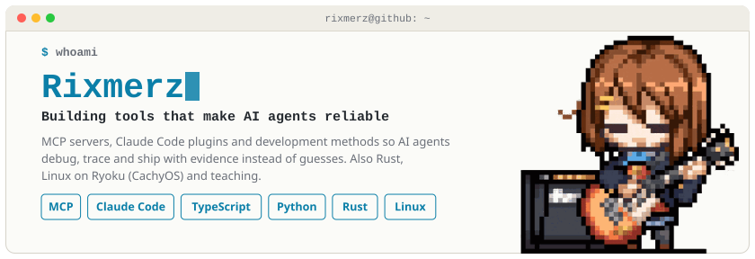
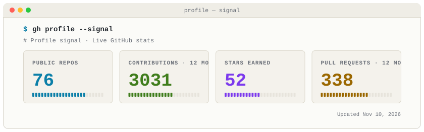
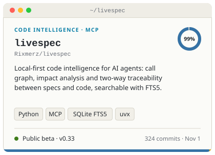
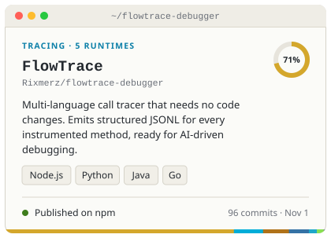
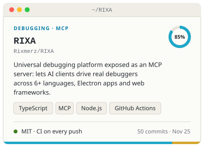
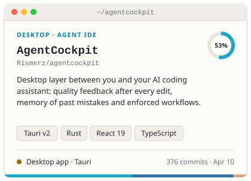
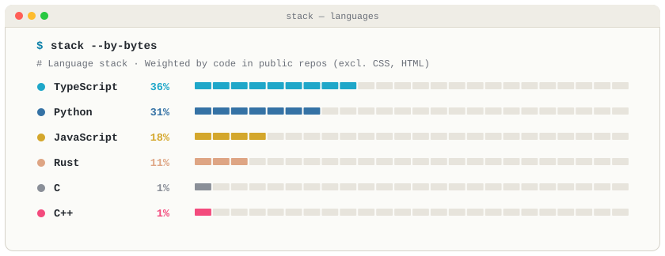
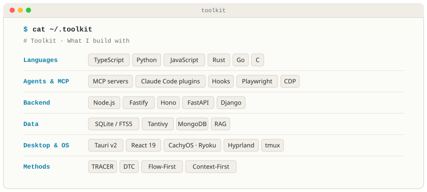
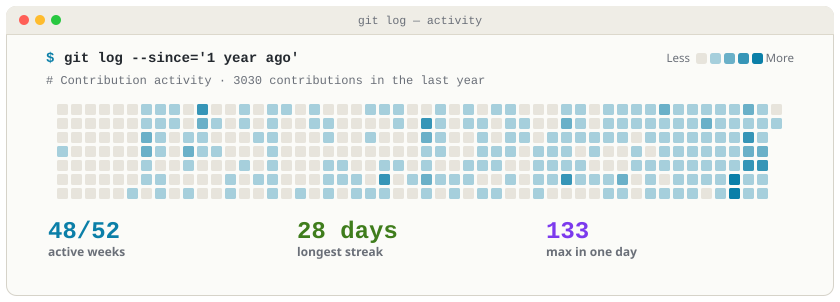

## Selected work

## Toolkit

## Consistency

Header pixel art: Yui Hirasawa (<i>K-On!</i>) by <a href="https://tenor.com/view/hal4822-yui-hirasawa-yui-guitar-k-on-pixel-gif-14331735206864296124">Hal4822</a>.

Profile designed as a gift by <a href="https://github.com/WaltherMoraRivera">@WaltherMoraRivera</a>. Thank you!

Cards generated by <a href="scripts/generate.py">scripts/generate.py</a> from GitHub API data.
